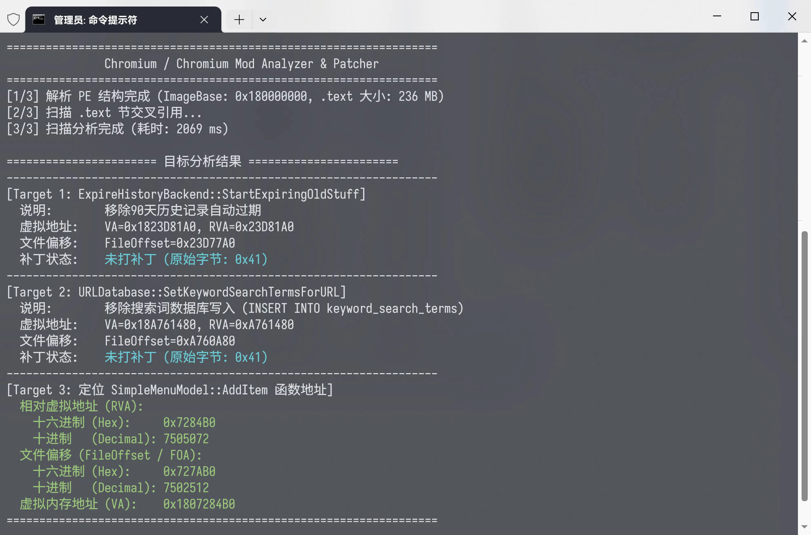

# ChromiumPatcher

一个用于分析与修改 Chromium 内核浏览器（`chrome.dll`）二进制文件的命令行辅助工具。基于内存映射与 [Iced](https://github.com/icedland/iced) x64 反汇编引擎实现快速特征定位与字节级修补。

## ✨ 功能特性

- **移除 90 天历史记录限制**：自动定位 `ExpireHistoryBackend::StartExpiringOldStuff` 并注入 `ret`（`0xC3`）指令，防止历史记录自动过期清理。
- **移除搜索关键词记录**：自动定位 `URLDatabase::SetKeywordSearchTermsForURL` 并禁用搜索词写入数据库。
- **自动提取函数偏移**：精准定位 `SimpleMenuModel::AddItem` 的 RVA（十六进制 / 十进制）与文件偏移（FOA），可直接用于配置 **CCMM** 右键菜单管理插件。
- **安全可逆**：执行补丁前自动创建 `.bak` 原始备份，支持随时通过参数一键还原。



## 🛠️ 依赖与环境

- **反汇编引擎**：[Iced](https://github.com/icedland/iced)
- **运行环境**：.NET Framework 4.8

## 🚀 使用方法

在命令行中运行 `ChromiumPatcher.exe` 并指定目标 `chrome.dll` 路径：

### 1. 分析目标与获取偏移（默认模式）

仅扫描目标文件，输出各目标函数的内存地址、文件偏移及当前补丁状态，不会修改文件：

```bash
ChromiumPatcher.exe "C:\Path\To\chrome.dll"
# 或显式指定参数
ChromiumPatcher.exe --analyze "C:\Path\To\chrome.dll"
```
